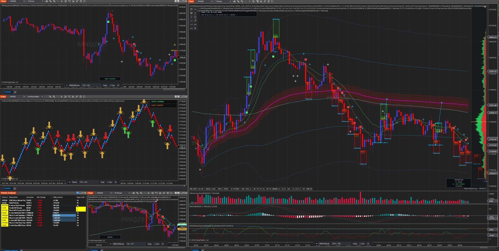
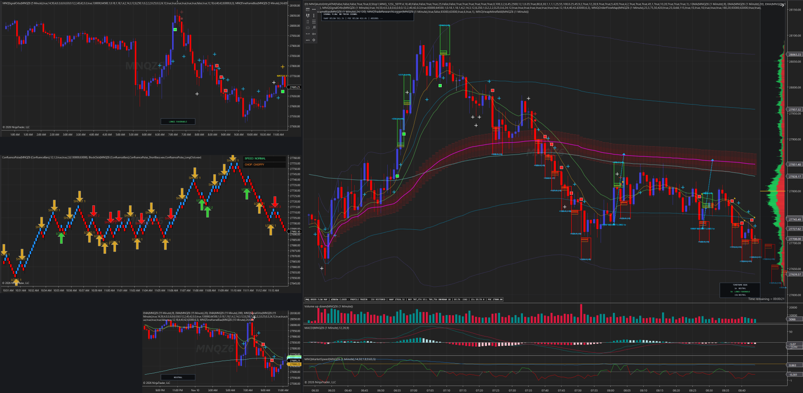
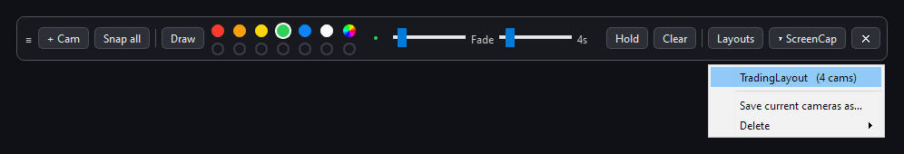

# ScreenCap

Lightweight Windows screen capture with resizable "camera" frames and an on-screen marker.
Nothing freezes the screen: frames are hollow, the marker is a click-through overlay, and PNGs
land straight in a folder.

**Homepage:** https://shiftingkill.github.io/screencap-site/

## In use

Four named cameras over NinjaTrader charts, saved as the layout `TradingLayout`:

`Snap all` saves each camera as its own PNG plus one stitched image, with the empty space
between the cameras squeezed out:

Layouts are saved and loaded from the toolbar:

## Features

**Cameras**
- Spawn any number of capture frames; drag the thin border to resize, drag the bar to move.
- Bar at the bottom centre of each frame fades out when not hovered and is never in a capture.
- Size drop-down: pixel presets up to 8K, inch and mm paper/photo sizes (at 96 px/in), or custom.
- `+ Cam` on a bar spawns another camera of the same size.
- Edges stick to screen and taskbar edges; a camera cannot be pushed off the desktop.
- `Name…` on a bar labels a camera (for example MNQ1minute); its PNGs are then saved as
  `MNQ1minute_<date>_<time>.png` with the name also stored inside the file.
- `Snap all` with two or more cameras also saves one stitched image: the shots laid out as on
  screen, with the empty space between them squeezed out.
- `Layouts` saves the current cameras under a name (for example TradingLayout) and restores them
  later; positions are stored per monitor.
- `Snap` saves one camera, `Snap all` saves every camera. Borders and bars of all cameras are
  hidden for the capture. The last shot is also copied to the clipboard.

**Marker**
- `Draw` turns on a marker across every monitor: six colours plus a colour wheel that remembers your last seven picks, 1-40 px tip.
- Strokes fade after 1-30 s, or stay until cleared with `Hold`.
- Right-click undoes the last stroke, Esc leaves draw mode.
- Marker strokes are included in captures.

**Hotkeys**: Ctrl+Alt+S snap all, Ctrl+Alt+D toggle draw, Ctrl+Alt+X clear marker.

The toolbar and cameras reopen where they were left; if that monitor is gone they return to the
main display. A tray icon offers *Reset toolbar position*.

| Camera | Marker | Size presets |
| --- | --- | --- |
|  |  |  |
